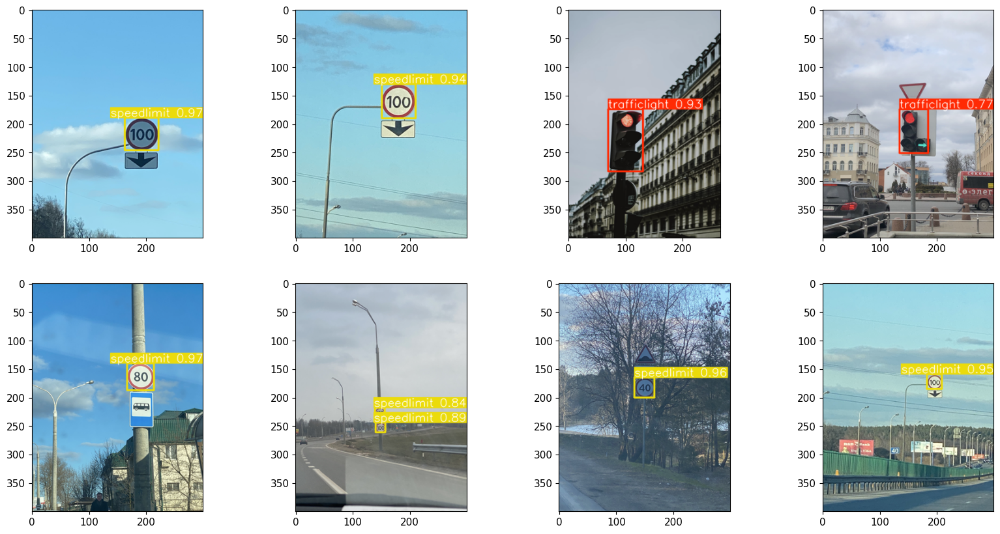

# Bearing-only PF Landmark Navigation with NuScenes

This project implements a prototype for landmark-based navigation using a **Particle Filter** (PF) and the **NuScenes** dataset. The focus lies on **bearing-only observations** derived from camera angles and detected landmarks.

## 🧠 What I Learned
- Setting up a structured research plan and timeline
- Deep learning for landmark detection (YOLO/Detectron2)
- Exporting and integrating trained models
- Georeferencing NuScenes sensor data
- Estimating bearing angles from camera images
- Implementing a particle filter for localization
- Handling data from multiple cameras
- Least Squares (LSQ) optimization techniques
- Data fusion of multiple observations

## 🛠️ Tools & Methods Used
- Python, PyTorch, OpenCV
- Detectron2 / YOLOv5 for landmark detection
- NuScenes SDK for data access and visualization
- Particle Filter implementation (custom)
- LSQ via NumPy/SciPy
- Git for version control

## 📁 Structure (Work Packages)
- A1: Planning & Research  
- A2: Deep Learning & Model Export  
- A3: Georeferencing, Landmark Detection & Fusion  

